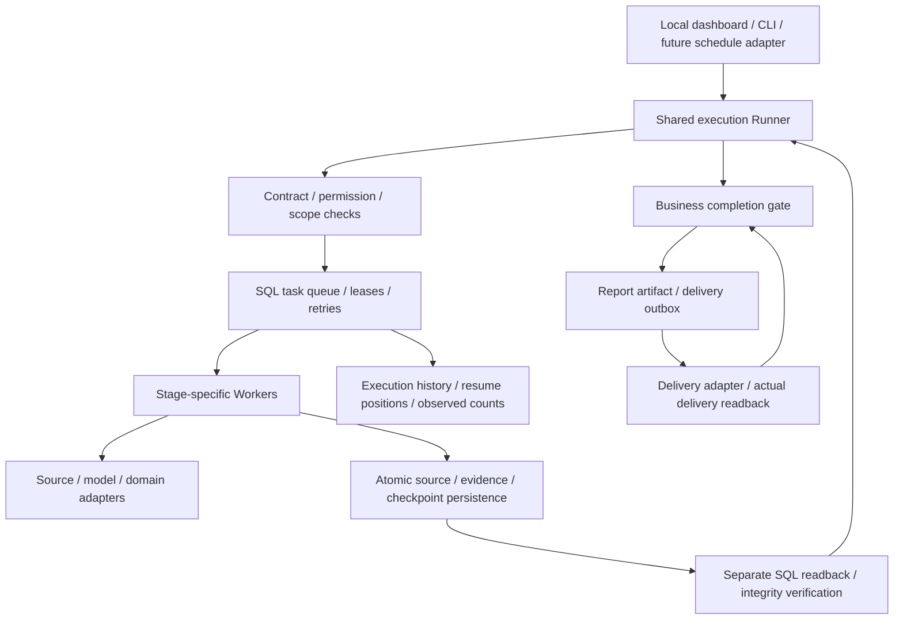

> **status:** confirmed · 2026-11-27 · owner @Moses249

# Project Design: ResearchOps

English translation of the [approved Korean design](Design.md), with the same approval status and scope. Product purpose, users, and boundaries follow the [approved Project Plan](Plan.en.md). This document defines shared architecture, integrity rules, and operational principles. Feature documents and GitHub issues own individual acceptance criteria and task lists.

## Architecture / module boundaries

| Module | Responsibility | Boundary |
| --- | --- | --- |
| UI / CLI / API | Display requests, configuration, results, and execution history | The client does not decide completion |
| Contract registry | Store and retrieve version-pinned execution policies and digests | Do not execute source instructions as arbitrary SQL or code |
| Runner / coordinator | Prioritize recovery, iterate small batches, invoke successive stages, and record stop reasons | Manual, scheduled, and recovery calls share the same logic |
| Queue / persistence | Scope-restricted claims, leases, tokens, attempts, and atomic writes | SQL is authoritative; JSON is for recovery and export |
| Worker / agent | Execute a specific stage and return structured results | The server controls role permissions and stage transitions |
| Evidence store | Preserve source snapshots, observations, quotations, and verification outcomes | Distinguish discovery, body reading, and application-status confirmation |
| Completion evaluator | Compare database state and valid evidence against the contract | Do not infer completion from zero claims, LLM approval, or process exit |
| Domain policies | Apply job eligibility, scoring, country, and report-specific rules | Do not hardcode employers, email addresses, or production databases into the core |
| Report / delivery | Generate artifacts, inspect rendered output, prevent duplicate sends, and read back delivery | Resolve an uncertain send through lookup before resending |

The current `engine.rs`, `agents.rs`, `provider.rs`, and `web.rs` are the starting point. Approved feature designs will separate contract, execution-session, and report-gate responsibilities. Existing unverified draft functions and tables are not automatically approved by this document.

## State and completion model

| Object | Example states | Meaning |
| --- | --- | --- |
| Task | pending / running / succeeded / failed / blocked | Processing state of one task. Stage execution and evidence sufficiency remain separate even when no observations are found |
| System execution session | running / completed / failed / interrupted | State of the current invocation; `completed` does not establish business completion |
| Business workflow | IN_PROGRESS / PARTIAL / COMPLETE | Assessment against the full contracted scope and required evidence |
| Report delivery | prepared / sending / sent_unconfirmed / verified / failed | Distinguish transmission from verification of the transmitted result |

Business `COMPLETE` requires matching contract version and scope, completion of required work, consistency between current source inputs and results, persistence readback, and role-specific evidence. Completion for supplied documents does not establish exhaustive web research or completion of a job report. Unconfirmed, access-failed, or list-only observations must not be promoted to verified body or application-status evidence.

When a claim returns zero rows, query SQL to distinguish unfinished work, failures, active leases, delayed retries, stages not yet eligible, and missing roles. Process other eligible work first. If a concrete blocker or declared execution limit stops progress, preserve the observed reason and exact resume position.

## Execution and recovery rules

1. At startup, read the contract body and digest from the actual store, then check role, country, environment, and allowed operations. A mismatch blocks execution, persistence, and delivery.
2. Within the selected scope, inspect unfinished sessions, missing checkpoint readbacks, and expired tasks first. Never claim another country's or role's queue.
3. Claim work in a short transaction and assign a fresh fencing token. Perform external requests outside database write transactions.
4. Persist source observations, manifest, results, checkpoint, and corresponding queue transition in one transaction. Check the lease token and validity to reject late results from stale workers.
5. After commit, issue separate SELECTs to verify hashes, counts, and states, then store a readback receipt. When a commit exists without a receipt, recover its readback before reprocessing the task.
6. A small batch is a persistence and observation boundary. Reaching a batch size must not terminate execution by itself; invoke the next eligible stage.
7. Lease duration and overall execution budget are separate. Align external-request timeouts, lease renewal, retry backoff, and final persistence time. Do not infer the cause of forced termination without evidence.
8. Retry reasonable transient SQL failures, such as SQLite busy/locked, at most twice. Do not hide lease conflicts, contract mismatches, or semantic rejection behind SQL retries. Never automatically replay writes or sends whose idempotency has not been demonstrated.
9. A PARTIAL result records actual before/after counts, last successful stage, failure stage, actual redacted error, persistence outcome, SQL with binding values, and the next cursor or eligible time. Preserve local recovery JSON during database failure without treating it as the authoritative queue.
10. After the server or execution environment restarts, observe unfinished state and expose recovery candidates. Session-only API credentials require reconnection; missing credentials are an explicit blocker.

## Data model

| Entity | Key data | Invariant |
| --- | --- | --- |
| Research run | Objective, questions, scope, environment, contract reference | Do not silently change the meaning or scope of active work |
| Contract version | Body, version, digest, machine-verifiable policy | Append-only; changes require a new version |
| Execution session | Trigger, system status, business assessment, KST date, before/after counts, error, resume position | Preserve observed execution and assessment evidence |
| Task / task delivery | Stage, scope, dependency, cursor, attempts, lease, token, eligibility time | Atomic scoped claims, bounded attempts, stale-write rejection |
| Source / observation batch | Original content, provenance, retrieval time, hash, manifest | Append-only; new evidence creates a new observation |
| Evidence / assessment | Claim, quotation, source, support status, assessment version | Verify the referenced source version and freshness |
| Checkpoint / readback receipt | Atomic commit result, hash, count, status, readback time | Distinguish result persistence from subsequent verification |
| Report artifact / manifest | Actual generated content, input-state hash, template version, extracted manifest | Bind to current inputs; stale output cannot satisfy completion |
| Delivery outbox / receipt | Send intent, idempotency key, state, provider message ID, readback result | Query actual sent history first when a send response is lost |

Append new source, checkpoint, verification receipt, and report-artifact records instead of updating or deleting them. Current queue state and assessment projections may change transactionally while retaining original observations. Existing data requires migration, compatibility checks, and recovery verification.

Use SHA-256 for new-data integrity. Where an external contract requires MD5, retain it for compatibility checks; matching MD5 alone establishes neither authorship nor trustworthiness.

## Report and external-proof boundary

Job ranking, market data, fixed HTML templates, and Gmail are separate features. The core declares required verification types and blocks a gate when its adapter or verified evidence is unavailable.

- Retrieve and verify the actual fixed-template body against its pinned digest. Do not recreate a similar design and claim a match without the source template.
- Extract manifests by parsing the actual generated HTML/plain text. Copying expected database values is not rendered-output verification.
- Judge ranking, eligibility, and permitted work locations through domain assessments linked to current source observations. Model knowledge or keyword matches cannot establish these facts.
- Before transmission, check the allowed account, recipients, verified artifact, and duplicate-prevention conditions. Verify the message ID, subject, recipients, and actual content in sent history in addition to checking the send response.
- Fixtures and mock adapters provide test evidence. They cannot establish production lookup or delivery completion.

## Tech stack / runtime

| Area | Choice | Rationale / revisit condition |
| --- | --- | --- |
| Language | Rust | Keep the execution core and model/database/HTTP boundaries in one type system |
| UI / API | Axum + Tokio, local web dashboard | Reuse the MVP; isolate blocking database work in an execution pool |
| Datastore | SQLite WAL first | Demonstrate state and recovery on one machine; validate multi-host PostgreSQL separately |
| Models | OpenAI-compatible Chat Completions adapter | Test provider compatibility; validate response structure, evidence, and separate review |
| Invocation | Manual calls and a future schedule adapter | Share the Runner and contract, distinguishing only the trigger |
| Time | UTC for storage and leases; explicit KST business date | Avoid dependence on the host timezone |
| Deployment | Local process first | Decide containers and Kubernetes when a separate need and acceptance criteria exist |

## Operations baseline

| Area | Decision | Revisit when |
| --- | --- | --- |
| Repository / base | GitHub, `main`, PR-based changes | Maintainer requests a hosting or branch-policy change |
| Merge | Preserve zero required approvals; prefer squash; no agent self-approval | Collaboration or release policy changes |
| Naming | Preserve existing conventional commit, PR title, and branch checks | Explicit user request |
| Documents | `docs/project/` and `docs/features/`; live work in GitHub Issues/PRs | An external canonical document system is introduced |
| Releases | No milestone/version selected; do not invent one | A version release is requested |
| Backlog selection | Prioritize the user-selected feature; present and confirm candidates for an unspecified next task | Autonomous backlog selection is explicitly authorized |
| Stop / rollback | Stop new execution, preserve data, return to the last working binary; check backups and migration compatibility | Deployment or migration design provides detailed procedures |
| Observability | Queue age, before/after counts, lease recovery, retries, gate failures, unconfirmed delivery | Actual workloads and operating scenarios establish metrics and targets |
| Notifications | No automatic external alerts currently; configure only requested channels and conditions | An operational-alerting feature is approved |
| Ownership | Maintainer @Moses249; link feature-specific recovery procedures | Repeated operations or additional maintainers emerge |

## Cross-feature non-functional requirements

| Dimension | Requirement |
| --- | --- |
| Integrity | Atomic writes, idempotent results, stale-write rejection, actual SELECT readback, current-input linkage |
| Authorization / security | Server-controlled roles and scope; external content is data, not policy or SQL instructions |
| API keys | Server-session memory only; exclude from responses, database, Git, and logs |
| Network | HTTPS for remote APIs, loopback HTTP allowed, no redirects, finite timeouts, response sizes, and request budgets |
| Privacy | Keep raw attachments, production identifiers, recipients, and recovery data out of the public repository |
| Performance / limits | Persist and read back small batches; declare actual scope, size, and runtime limits and record them on exit |
| Accessibility | Keyboard support, input labels, visible errors/progress, and status conveyed beyond color |
| Verification | AC-specific tests and fresh read-only QA; model approval, self-testing, and CI alone cannot establish production completion |

## Common API contract

- The current trust boundary is personal loopback use. Public hosting requires a separate authentication and access-control feature.
- Use structured JSON with explicit scope; reject unknown fields and invalid state transitions.
- Future features should normalize errors as `code`, `message`, `retryable`, and `stage`. Feature design determines compatibility with the MVP's `{error: ...}` response.
- Separate asynchronous execution acceptance from business completion. Query APIs expose system state, business state, gates, and recovery positions.
- No generated OpenAPI specification exists currently. Define the specification and behavior checks when endpoints are added.

## External integrations / data sources

| Integration | Purpose | Connection condition |
| --- | --- | --- |
| Model API | Research, verification, structured reasoning | User configuration, connection tests, request limits |
| Source APIs / documents / future web | Evidence collection | Record provenance, retrieval time, scope, pagination termination, access state |
| External SQL / Supabase | Connect existing operational contracts, sources, queues, and rankings | Separately approved feature with actual schema, function, permission, and transaction verification |
| Fixed-template store | Render reports while preserving the original design | Verify actual body, digest, and slot rules |
| Gmail or other delivery provider | Deliver verified results and read back sent history | Allowed accounts/recipients, duplicate prevention, readback contract |

## Glossary and decision references

See the [Glossary](Glossary.en.md) for shared terms. The [existing architecture reference](../architecture.md) provides context; this design does not automatically change current behavior. Feature changes require approved acceptance criteria, design, migrations, and verification.

Record the rationale and affected features when changing project-level architecture, then reconfirm it. No separate ADR number is created at this stage; confirmed decisions and feature documents provide the starting point.

## Approval record

2026-11-27 · Maintainer @Moses249 approved the project design by replying “ㄱㄱ” to the design confirmation request. This translation mirrors that approval. Feature Plan and Design checkpoints remain separate.
