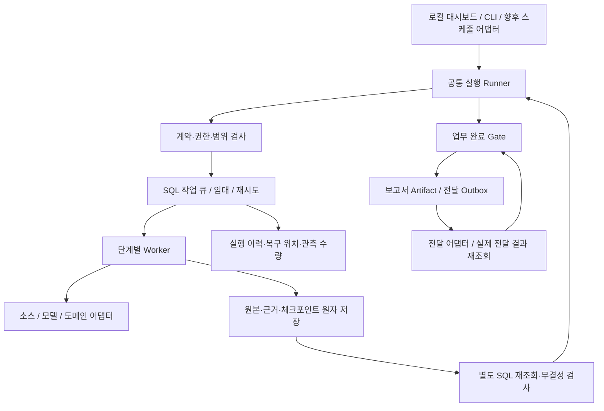

> **status:** confirmed · 2026-11-27 · owner @Moses249

# Project Design: ResearchOps

제품 목적·사용자·범위는 [확정된 Project/Plan](Plan.md)을 따른다. 이 문서는 기능들이 공유할 아키텍처·무결성·운영 기준을 정의하며, 개별 기능의 AC와 작업 목록은 해당 기능 문서와 GitHub 이슈가 관리한다.

## Architecture / module boundaries

| 모듈 | 책임 | 경계 |
| --- | --- | --- |
| UI / CLI / API | 요청·설정·결과·실행 이력 표시 | 완료 여부를 클라이언트에서 결정하지 않음 |
| Contract registry | 버전이 고정된 실행 정책과 검증 digest 저장·조회 | 원문 지시를 임의 SQL이나 코드로 실행하지 않음 |
| Runner / coordinator | 복구 우선 선택, 작은 묶음 반복, 단계 연속 호출, 정지 사유 기록 | 수동·예약·복구 실행이 같은 로직을 사용 |
| Queue / persistence | 범위가 제한된 claim, 임대·토큰·시도 수, 원자적 저장 | 큐의 원장은 SQL이며 JSON은 복구·출력 자료 |
| Worker / agent | 연구·검증 등 특정 단계 수행, 구조화된 결과 반환 | 역할 권한·단계 전이는 서버가 통제 |
| Evidence store | 불변 소스 스냅샷·관측·인용·검증 결과 | 후보 발견·본문 열람·접수 확인을 구분 |
| Completion evaluator | DB 상태와 유효한 증거를 계약에 대조 | claim 0건·LLM 승인·프로세스 종료로 완료를 추정하지 않음 |
| Domain policies | 채용 자격·점수·국가·보고서별 완료 조건 | 공통 엔진에 특정 기업·이메일·생산 DB를 하드코딩하지 않음 |
| Report / delivery | Artifact 생성, 실제 렌더 결과 검사, 발송 중복 방지·재조회 | 전달 불명 상태에서는 재발송보다 조회를 우선 |

현재의 `engine.rs`, `agents.rs`, `provider.rs`, `web.rs`는 출발점이다. 계약·실행 세션·보고서 Gate는 승인된 기능 설계에서 모듈로 분리한다. 기존 미검증 초안의 함수·테이블이 이 설계의 자동 승인 대상은 아니다.

## State and completion model

| 대상 | 상태 예시 | 의미 |
| --- | --- | --- |
| 작업 | pending / running / succeeded / failed / blocked | 한 작업 단위의 처리 상태. 관측이 없다는 결과도 단계 처리와 근거 충족 여부를 따로 기록 |
| 시스템 실행 세션 | running / completed / failed / interrupted | 이번 호출의 동작 상태. `completed`는 업무 완료를 뜻하지 않음 |
| 업무 | IN_PROGRESS / PARTIAL / COMPLETE | 계약이 요구한 전체 범위와 증거에 따른 판정 |
| 전달 | prepared / sending / sent_unconfirmed / verified / failed | 실제 전송과 전달 결과 재확인을 구분 |

업무 `COMPLETE`에는 계약 버전·범위 일치, 필요한 작업의 완료, 최신 원본과 결과의 일치, 저장 재조회, 역할별 증거가 모두 필요하다. 연구 문서 범위의 완료는 웹 전체 조사나 채용 리포트 완료를 뜻하지 않는다. 미확인·접근 실패·목록만 관측한 상태를 실제 본문·접수 확인으로 승격하지 않는다.

claim이 0건이면 미완료·실패·유효 임대·지연 재시도·미도래 단계·누락된 역할을 SQL로 구분한다. 다른 처리 가능 작업을 먼저 진행하고, 확인된 차단이나 명시한 실행 한도 때문에 멈출 경우 실제 사유와 다음 재개 위치를 남긴다.

## Execution and recovery rules

1. 시작 시 계약 body와 digest를 실제 저장소에서 재조회하고 역할·국가·실행 환경·허용 동작을 검사한다. 불일치는 실행·저장·전달을 차단한다.
2. 선택된 범위의 미완료 실행·체크포인트 재조회 실패·만료 작업을 우선 조사한다. 다른 국가나 역할의 큐를 가져오지 않는다.
3. 짧은 트랜잭션으로 작업을 claim하고 새 fencing token을 부여한다. 외부 요청은 DB 쓰기 트랜잭션 밖에서 실행한다.
4. 원본·manifest·결과·체크포인트·해당 큐 전이를 같은 트랜잭션으로 저장한다. 임대 토큰·유효 기간을 검증해 늦은 작업자의 결과를 거절한다.
5. 커밋 후 별도 SELECT로 해시·수량·상태를 읽고 확인 receipt를 저장한다. 저장은 됐으나 receipt가 없는 경우 재처리보다 재조회 복구를 우선한다.
6. 작은 묶음은 저장·관측 경계다. 묶음 수에 도달했다는 이유만으로 실행을 종료하지 않고 다음 처리 가능한 단계를 호출한다.
7. lease 만료와 전체 실행 예산은 별개다. 외부 요청 timeout·lease 갱신·재시도 backoff·최종 저장 시간을 정합성 있게 설계한다. 강제 종료 원인은 관측 없이 단정하지 않는다.
8. SQLite busy/locked 등 합리적 일시 오류만 최대 두 번 재시도한다. 임대 충돌·계약 불일치·의미 검증 실패를 SQL 재시도로 숨기지 않는다. 재실행 안전성이 증명되지 않은 쓰기와 발송은 자동 replay하지 않는다.
9. PARTIAL에는 실제 전후 수량, 마지막 성공 단계, 실패 단계, 비밀을 제거한 실제 오류, 저장 여부, SQL과 바인딩 값, 다음 cursor/가능 시각을 기록한다. DB 장애 시 로컬 복구 JSON을 보존하며 이를 큐 원장으로 취급하지 않는다.
10. 서버·실행 환경이 다시 시작되면 미완료를 관측해 복구 대상으로 표시한다. 세션 메모리에만 있던 API 키는 재연결이 필요하며, 자격 증명 부재를 명시적 차단 사유로 표시한다.

## Data model

| 엔터티 | 핵심 데이터 | 불변식 |
| --- | --- | --- |
| Research run | 목표, 질문, 범위, 실행 환경, 계약 참조 | 활성 실행의 의미와 범위를 암묵적으로 바꾸지 않음 |
| Contract version | 원문, 버전, digest, 검증 가능한 정책 | append-only; 변경은 새 버전 |
| Execution session | trigger, 시스템 상태, 업무 판정, KST 기준일, 전후 수량, 오류·재개 위치 | 판정 근거와 실제 실행 이력을 보존 |
| Task / delivery | 단계, scope, dependency, cursor, 시도 수, 임대·토큰·가능 시각 | scope 내 원자 claim, 횟수 제한, stale write 거절 |
| Source / observation batch | 원본, 출처, 조회 시각, 해시, manifest | append-only; 새 근거는 새 관측 |
| Evidence / assessment | 주장·인용·출처·지원 상태·평가 버전 | 평가가 참조한 원본과 최신성 확인 |
| Checkpoint / readback receipt | 원자 저장 결과, 해시·수량·상태, 재조회 시각 | 결과 커밋과 재조회 확인을 구분 |
| Report artifact / manifest | 실제 생성 본문, 입력 상태 hash, 템플릿 버전, 추출 manifest | 현재 입력과 연결되며 오래된 결과로 완료를 충족하지 않음 |
| Delivery outbox / receipt | 발송 의도, 중복 방지 키, 상태, 제공자 message ID, 재조회 결과 | 응답 유실 시 먼저 실제 전송 내역 조회 |

원본·체크포인트·검증 receipt·보고서 Artifact는 수정·삭제 대신 새 기록을 추가한다. 현재 큐 상태와 최신 평가 projection은 트랜잭션으로 갱신할 수 있으나 원본 관측을 덮어쓰지 않는다. 이미 존재하는 데이터에는 migration과 호환성·복구 검증이 필요하다.

SHA-256을 새 데이터의 무결성 검사에 사용한다. 외부 계약이 요구하는 MD5는 호환성 확인에 함께 사용하며, MD5 일치만으로 작성자 인증이나 신뢰성을 주장하지 않는다.

## Report and external-proof boundary

채용 순위·시장 자료·고정 HTML·Gmail은 별도 기능으로 구현한다. 공통 엔진은 필요한 검증 종류를 선언하고, 해당 어댑터가 없거나 증거가 검증되지 않았으면 Gate를 통과시키지 않는다.

- 고정 템플릿은 실제 body와 pin한 digest를 조회·확인한 뒤 사용한다. 원문 없이 비슷한 디자인을 만들어 일치했다고 표시하지 않는다.
- Manifest는 실제 생성된 HTML/plain text를 파싱하여 추출한다. DB의 기대 값을 그대로 복사한 자료는 렌더 검증 증거가 아니다.
- 순위·자격·허용 근무 지역은 최신 원본과 연결된 도메인 평가로 판정한다. 모델의 일반 지식이나 키워드로 확정하지 않는다.
- 전송은 허용된 계정·수신자·검증된 Artifact·중복 방지 조건을 확인한 후 수행한다. 발송 응답뿐 아니라 전송함에서 message ID·제목·수신자·실제 내용을 다시 확인한다.
- Fixture와 모의 어댑터 결과는 테스트 증거다. Production 조회·발송 완료를 증명하지 않는다.

## Tech stack / runtime

| 영역 | 선택 | 이유·재검토 조건 |
| --- | --- | --- |
| 언어 | Rust | 공통 실행 코어와 모델·DB·HTTP 경계를 같은 타입 체계로 관리 |
| UI / API | Axum + Tokio, 로컬 웹 대시보드 | 현재 MVP를 재사용하고 blocking DB 작업은 실행 풀로 분리 |
| 저장소 | SQLite WAL 우선 | 단일 머신에서 상태·복구를 먼저 검증. 다중 호스트는 PostgreSQL 어댑터 기능으로 별도 검증 |
| 모델 | OpenAI 호환 Chat Completions 어댑터 | provider별 지원 여부를 연결 테스트. 모델 응답은 구조·근거·별도 검증을 거침 |
| 실행 입력 | 수동 호출 + 향후 스케줄 어댑터 | 공통 Runner와 계약을 공유하고 trigger만 구분 |
| 시간 | 저장·lease는 UTC, 업무 기준일은 명시적 KST | 호스트 시간대에 의존하지 않음 |
| 배포 | 로컬 프로세스 우선 | 배포·컨테이너·Kubernetes는 별도 필요와 검증 기준이 생길 때 결정 |

## Operations baseline

| 영역 | 결정 | 재검토 시점 |
| --- | --- | --- |
| 저장소·base | GitHub, `main`, PR 경유 | 유지보수자가 저장소·브랜치 정책 변경 요청 시 |
| Merge | 승인 0개 유지, squash 권장, 에이전트 자기 승인 금지 | 협업·릴리스 정책이 바뀔 때 |
| 명명 | 기존 Conventional Commit·PR 제목·브랜치 검사 유지 | 명시적 사용자 요청 시 |
| 문서 | `docs/project/`, `docs/features/`; 현재 작업은 GitHub Issues/PRs | 외부 문서 원장이 도입될 때 |
| 릴리스 | milestone·버전 미지정; 임의 생성하지 않음 | 버전 릴리스를 요청할 때 |
| Backlog pull | 현재 사용자가 지정한 기능 우선. 무지명 다음 작업은 우선순위 후보를 제시하고 확인 | 자율 pull 권한을 명시적으로 승인할 때 |
| 중단·rollback | 새 실행 중지, 기존 데이터 보존, 마지막 정상 binary로 복귀. DB는 백업·migration 호환성을 확인 | 배포·migration 기능 설계 시 구체화 |
| 관측 | queue age, 처리 전후 수량, 임대 회복·재시도 수, Gate 실패, 전달 미확인 | 실제 부하·운영 시나리오에 따라 지표·목표 확정 |
| 알림 | 현재 자동 외부 알림 없음. 사용자가 요청한 채널·조건만 설정 | 운영 알림 기능 승인 시 |
| 책임 | 유지보수자 @Moses249; 기능별 복구 절차를 해당 문서에 연결 | 반복 운영·추가 유지보수자 도입 시 |

## Cross-feature non-functional requirements

| 차원 | 기준 |
| --- | --- |
| 무결성 | 원자 저장, 멱등 결과, stale write 차단, 실제 SELECT readback과 최신 입력 연결 |
| 권한·보안 | 역할·scope는 서버가 통제. 외부 본문은 데이터이며 정책·SQL 지시로 승격하지 않음 |
| API 키 | 현재 서버 세션 메모리에만 저장. 응답·DB·Git·로그에 포함하지 않음 |
| 네트워크 | 원격 API HTTPS, loopback HTTP 허용, redirect 차단, 유한 timeout·응답 크기·호출 예산 |
| 개인정보 | 원본 첨부·production 식별자·수신자·복구 자료를 공개 저장소에 넣지 않음 |
| 성능·제한 | 작은 묶음으로 저장·재조회. 실제 설정된 범위·크기·시간 제한을 명시하고 종료 이력에 기록 |
| 접근성 | 키보드 사용, 입력 label·오류·진행 상태 표시, 색만으로 판정하지 않음 |
| 검증 | AC별 테스트와 fresh read-only QA. 모델 승인·자체 테스트·CI만으로 production 완료를 선언하지 않음 |

## Common API contract

- 현재 인증·권한 경계는 loopback 개인 사용이다. 공개 호스팅 전에 별도 인증·접근 제어 기능이 필요하다.
- 요청은 구조화된 JSON과 명시적 scope를 사용하고 알 수 없는 필드·잘못된 상태 전이를 거절한다.
- 후속 기능에서 오류를 `code`, `message`, `retryable`, `stage`로 정규화한다. 현재 MVP의 `{error: ...}`와 호환성은 기능 설계에서 정한다.
- 비동기 실행 시작 응답과 업무 완료 응답을 구분하고, 조회 API에서 시스템 상태·업무 상태·Gate·복구 위치를 제공한다.
- 생성된 OpenAPI 명세는 현재 없다. 실제 endpoint가 추가될 때 명세와 동작 검증을 함께 정의한다.

## External integrations / data sources

| 연동 | 목적 | 연결 조건 |
| --- | --- | --- |
| 모델 API | 연구·검증·구조화된 추론 | 사용자 설정·연결 테스트·호출 제한 |
| 소스 API / 문서 / 향후 웹 | 근거 수집 | 출처·조회 시각·범위·페이지 종료·접근 상태 기록 |
| 외부 SQL / Supabase | 기존 운영 계약·원본·큐·순위와 연결 | 별도 승인된 연동 기능, 실제 schema·함수·권한·트랜잭션 검증 |
| 고정 템플릿 저장소 | 원형을 보존한 보고서 렌더링 | 실제 body·digest와 슬롯 규칙 확인 |
| Gmail 등 전달 제공자 | 검증된 결과 전달·발송함 재확인 | 허용 계정·수신자·중복 방지·readback 계약 |

## Glossary and decision references

용어는 [Glossary](Glossary.md)에 정의한다. 기존 [구현 아키텍처](../architecture.md)는 참고 자료이며 이 설계가 기존 동작을 자동 변경하지 않는다. 기능별 변경은 승인된 AC·설계·migration·검증으로 반영한다.

프로젝트 차원의 추가 설계 변경은 근거·영향 기능을 기록하고 다시 확인한다. 지금은 별도 ADR 번호를 만들지 않으며, 이 문서의 확인된 결정과 기능 문서를 출발점으로 삼는다.

## Approval record

2026-11-27 · 유지보수자 @Moses249가 설계 확정 질문에 “ㄱㄱ”로 응답하여 프로젝트 설계를 승인했다. 영어 번역은 동일한 설계와 승인 상태를 반영한다. 기능별 Plan·Design 체크포인트는 별도로 진행한다.
